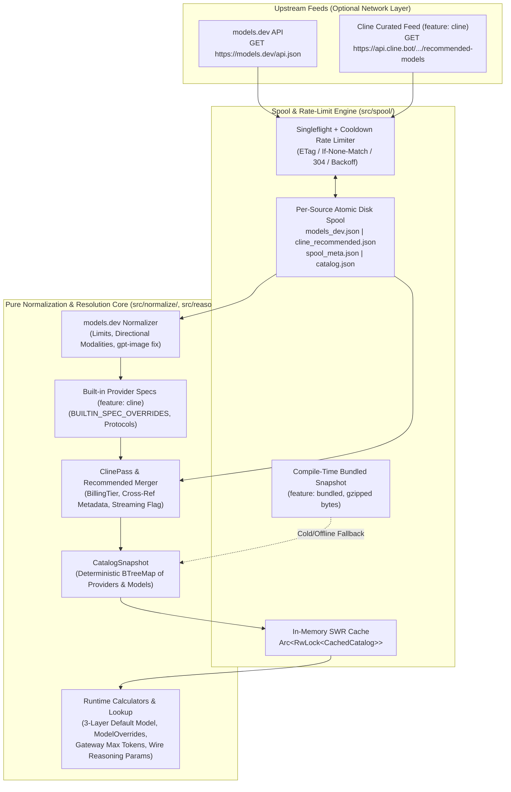
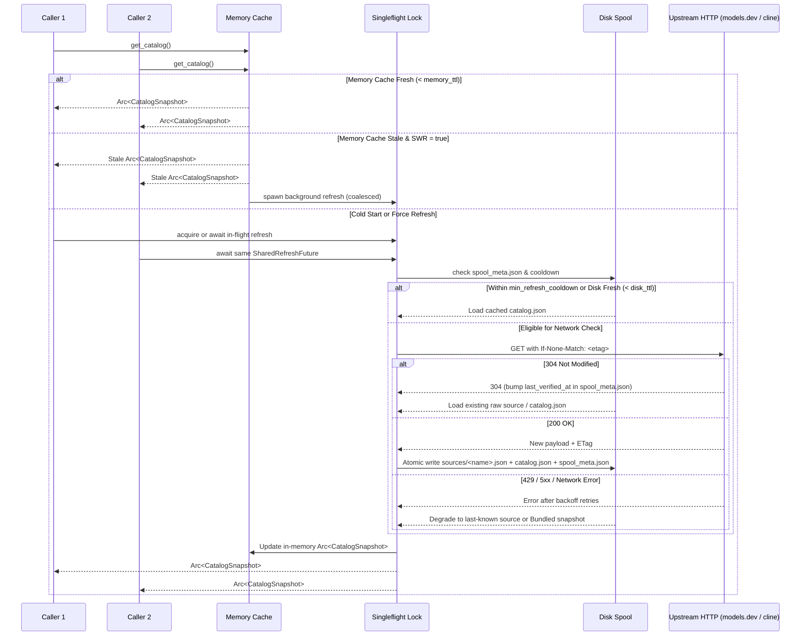

# Architecture & System Design (`models-catalog`)

## 1. Design Principles

1. **First-Class Standalone Ergonomics:** `models-catalog` is designed as a general-purpose Rust crate suitable for CLI tools, backend orchestrators, IDE extensions, and desktop/web UIs.
2. **Hermetic Core vs. Optional I/O:** Parsing, normalization, lookup, override resolution, and token/reasoning calculations live in pure, synchronous modules with zero network or filesystem dependencies. Async HTTP fetching (`reqwest-client`) and atomic disk persistence (`disk-spool`) layer cleanly on top via Cargo feature flags.
3. **Composable Overlay Pipeline:** `models.dev` serves as the foundational registry (`200+` providers, `6,000+` models). Vendor overlays—such as the `cline` feature (`BUILTIN_SPEC_OVERRIDES` + `api.cline.bot` recommended/ClinePass feed) or caller-supplied custom overlays—enrich and merge deterministically onto the base catalog.
4. **Per-Source Spooling & Graceful Degradation:** Each upstream feed (`models.dev` and `api.cline.bot`) is cached and ETag-tracked independently on disk alongside the merged `catalog.json`. If an upstream returns `304 Not Modified` or fails with `5xx`/timeout, the normalizer merges using the last-known good payload (or compile-time `bundled` snapshot) without failing the caller.
5. **Injectable Configuration (Zero Ambient Lock-In):** Callers can inject custom spool directories, custom upstream URLs, custom HTTP headers/clients, or in-memory snapshots so tests are 100% deterministic.

---

## 2. System Data Flow



---

## 3. Repository & Module Layout

```text
models-catalog/
├── Cargo.toml
├── README.md
├── docs/
│   ├── ARCHITECTURE.md
│   ├── NORMALIZATION_AND_PARITY.md
│   └── IMPLEMENTATION_PLAN.md
├── parity-harness/
│   ├── package.json            # Pinned @cline/llms dependency for oracle generation
│   └── dump-oracle.ts          # Bun script exporting builtin_specs.json & oracle-expected.json
├── assets/
│   └── bundled_catalog.json.gz # Compile-time fallback snapshot (feature = "bundled")
├── src/
│   ├── lib.rs                  # Public API exports, CatalogManager & Builder re-exports
│   ├── error.rs                # CatalogError & ContextOverflowError (thiserror)
│   ├── config.rs               # SpoolConfig, RateLimitConfig, UpstreamUrls, OverlayConfig
│   ├── types.rs                # CatalogSnapshot, ProviderSpec, ModelInfo, Limit, Modalities,
│   │                           # Cost, BillingTier, ModelOverrides, SourceStatus (+ ts-rs)
│   ├── builtins.rs             # Port/generated BUILTIN_SPEC_OVERRIDES & ProviderProtocol
│   ├── generated/
│   │   └── builtin_specs.json  # Generated from @cline/llms via parity-harness
│   ├── lookup.rs               # Flexible model lookup, ID alias resolution, override layering
│   ├── normalize/
│   │   ├── mod.rs              # Pipeline coordinator combining base + builtins + overlays
│   │   ├── models_dev.rs       # Raw models.dev parser & normalizer
│   │   ├── cline_feed.rs       # api.cline.bot parser, cline-pass/* & openrouter merger
│   │   ├── limits.rs           # Token limit constants, resolve_max_input_tokens, gateway budget
│   │   ├── modalities.rs       # Directional modality cleaner, gpt-image fix, is_chat_model()
│   │   └── resolution.rs       # Release-date sorting & 3-layer resolve_default_model()
│   ├── reasoning.rs            # ReasoningEffort clamping & to_wire_reasoning_params()
│   ├── local_settings.rs       # Reader/validator for ~/.cline/data/settings/providers.json
│   ├── bundled.rs              # Decompression & loading of assets/bundled_catalog.json.gz
│   ├── spool/
│   │   ├── mod.rs              # CatalogManager orchestration
│   │   ├── memory.rs           # In-memory RwLock snapshot + SWR background task spawner
│   │   ├── disk.rs             # Atomic temp-file writer, per-source cache & spool_meta.json
│   │   └── limiter.rs          # Singleflight lock, per-source cooldown, ETag 304 & retry backoff
│   └── bin/
│       └── main.rs             # CLI binary (`models-catalog`, feature = "cli")
└── tests/
    ├── fixtures/
    │   ├── models-dev.sample.json
    │   ├── cline-recommended.sample.json
    │   └── oracle-expected.json
    ├── normalization_tests.rs  # Unit/integration tests for limits, modalities, defaults, reasoning
    ├── spool_tests.rs          # Wiremock tests for singleflight, 304 ETag, 429 backoff, SWR
    └── oracle_parity.rs        # Differential parity suite against @cline/llms oracle
```

---

## 4. Core Data Models (`src/types.rs`)

All public structs use `BTreeMap` for map fields so serialized JSON snapshots have deterministic key ordering suitable for Git diffs. When compiled with `--features ts-bindings`, all public types derive `ts_rs::TS`.

### `CatalogSnapshot`
```rust
#[derive(Debug, Clone, Serialize, Deserialize, PartialEq)]
#[cfg_attr(feature = "ts-bindings", derive(ts_rs::TS))]
pub struct CatalogSnapshot {
    /// Schema version of the normalized snapshot (e.g., 1).
    pub schema_version: u32,
    /// UTC timestamp when this snapshot was assembled.
    pub generated_at: DateTime<Utc>,
    /// Per-source provenance and freshness status (e.g., "models_dev", "cline_recommended").
    pub sources: BTreeMap<String, SourceStatus>,
    /// True if any optional upstream failed and fell back to cached/bundled data.
    pub degraded: bool,
    /// Normalized provider map keyed by canonical provider ID (e.g., "anthropic", "cline-pass").
    pub providers: BTreeMap<String, ProviderSpec>,
}
```

### `SourceStatus` & `DataOrigin`
```rust
#[derive(Debug, Clone, Copy, Serialize, Deserialize, PartialEq, Eq)]
#[cfg_attr(feature = "ts-bindings", derive(ts_rs::TS))]
#[serde(rename_all = "snake_case")]
pub enum DataOrigin {
    Live,
    NotModified304,
    DiskSpool,
    BundledFallback,
    CustomInput,
}

#[derive(Debug, Clone, Serialize, Deserialize, PartialEq, Eq)]
#[cfg_attr(feature = "ts-bindings", derive(ts_rs::TS))]
pub struct SourceStatus {
    pub origin: DataOrigin,
    pub last_fetched_at: Option<DateTime<Utc>>,
    pub last_verified_at: Option<DateTime<Utc>>,
    pub etag: Option<String>,
    pub warning: Option<String>,
}
```

### `ProviderSpec` & `ProviderProtocol`
```rust
#[derive(Debug, Clone, Copy, Serialize, Deserialize, PartialEq, Eq)]
#[cfg_attr(feature = "ts-bindings", derive(ts_rs::TS))]
#[serde(rename_all = "snake_case")]
pub enum ProviderProtocol {
    Anthropic,
    OpenAiCompatible,
    OpenAiResponses,
    Google,
    Bedrock,
    Vertex,
    Ollama,
    ClinePass,
}

#[derive(Debug, Clone, Serialize, Deserialize, PartialEq)]
#[cfg_attr(feature = "ts-bindings", derive(ts_rs::TS))]
pub struct ProviderSpec {
    pub id: String,
    pub name: String,
    pub protocol: ProviderProtocol,
    pub base_url: Option<String>,
    pub env_vars: Vec<String>,
    pub doc_url: Option<String>,
    /// Resolved or pinned default model ID for this provider.
    pub default_model_id: Option<String>,
    /// True when the provider endpoint rejects non-streaming requests (e.g., api.cline.bot / cline-pass).
    pub requires_streaming: bool,
    /// Ordered list of model IDs sorted by release_date descending (newest first), tie-broken lexicographically.
    pub sorted_model_ids: Vec<String>,
    /// Models keyed by model ID.
    pub models: BTreeMap<String, ModelInfo>,
}
```

### `ModelInfo`, `Limit`, `Modalities`, `Cost`, `BillingTier`
```rust
#[derive(Debug, Clone, Serialize, Deserialize, PartialEq)]
#[cfg_attr(feature = "ts-bindings", derive(ts_rs::TS))]
pub struct ModelInfo {
    pub id: String,
    pub name: String,
    pub provider_id: String,
    /// Upstream family identifier if available (e.g., "claude-sonnet", "gpt-image").
    pub family: Option<String>,
    /// Normalized total context window (`limit.context`).
    pub context_window: Option<u64>,
    /// Resolved max input tokens (`min(context, input)` or fallback `128_000`).
    pub max_input_tokens: u64,
    /// Resolved max output tokens (`limit.output` or fallback `4_096`).
    pub max_tokens: u64,
    /// Raw upstream limits preserved for inspection.
    pub raw_limit: Limit,
    /// Sanitized directional modalities (`None` if unspecified or pruned as incomplete).
    pub modalities: Option<Modalities>,
    /// Token pricing in USD per 1M tokens.
    pub cost: Option<Cost>,
    /// True if model supports reasoning/thinking tokens.
    pub supports_reasoning: bool,
    /// Supported discrete reasoning effort levels (e.g., `[None, Low, Medium, High, Max]`).
    pub reasoning_options: Vec<ReasoningEffort>,
    /// Default reasoning effort if recommended by upstream/overlay.
    pub default_reasoning_effort: Option<ReasoningEffort>,
    /// True if model supports structured tool/function calling.
    pub supports_tool_call: bool,
    /// True if model supports prompt caching.
    pub supports_prompt_cache: bool,
    /// ISO-8601 release date string (`YYYY-MM-DD`) if reported.
    pub release_date: Option<String>,
    /// Billing tier annotation (`Subscription`, `Free`, `Credits`).
    pub billing_tier: Option<BillingTier>,
    /// True if curated in the recommended models feed.
    pub is_recommended: bool,
    /// True if underlying provider requires streaming for this model.
    pub requires_streaming: bool,
}

#[derive(Debug, Clone, Default, Serialize, Deserialize, PartialEq, Eq)]
#[cfg_attr(feature = "ts-bindings", derive(ts_rs::TS))]
pub struct Limit {
    pub context: Option<u64>,
    pub input: Option<u64>,
    pub output: Option<u64>,
}

#[derive(Debug, Clone, Copy, Serialize, Deserialize, PartialEq, Eq, PartialOrd, Ord, Hash)]
#[cfg_attr(feature = "ts-bindings", derive(ts_rs::TS))]
#[serde(rename_all = "lowercase")]
pub enum Modality {
    Text,
    Image,
    Audio,
    Video,
    Pdf,
}

#[derive(Debug, Clone, Serialize, Deserialize, PartialEq, Eq)]
#[cfg_attr(feature = "ts-bindings", derive(ts_rs::TS))]
pub struct Modalities {
    pub input: Vec<Modality>,
    pub output: Vec<Modality>,
}

#[derive(Debug, Clone, Serialize, Deserialize, PartialEq)]
#[cfg_attr(feature = "ts-bindings", derive(ts_rs::TS))]
pub struct Cost {
    pub input: Option<f64>,
    pub output: Option<f64>,
    pub reasoning: Option<f64>,
    pub cache_read: Option<f64>,
    pub cache_write: Option<f64>,
}

#[derive(Debug, Clone, Copy, Serialize, Deserialize, PartialEq, Eq)]
#[cfg_attr(feature = "ts-bindings", derive(ts_rs::TS))]
#[serde(rename_all = "snake_case")]
pub enum BillingTier {
    Subscription,
    Free,
    Credits,
}
```

### `ModelOverrides` (Precedence: `caller_override > local_settings > catalog > default`)
```rust
#[derive(Debug, Clone, Default, Serialize, Deserialize, PartialEq)]
#[cfg_attr(feature = "ts-bindings", derive(ts_rs::TS))]
pub struct ModelOverrides {
    pub context_window: Option<u64>,
    pub max_input_tokens: Option<u64>,
    pub max_output_tokens: Option<u64>,
    pub default_reasoning_effort: Option<ReasoningEffort>,
    pub reasoning_options: Option<Vec<ReasoningEffort>>,
    pub requires_streaming: Option<bool>,
}
```

---

## 5. Caching, Disk Spooling & Rate-Limiting State Machine (`src/spool/`)

`CatalogManager` is designed so an application can call `manager.get_catalog().await` thousands of times per second without overwhelming `models.dev` or `api.cline.bot`.

### Configuration (`SpoolConfig`)
| Parameter | Default | Description |
| :--- | :--- | :--- |
| `memory_ttl` | `15 minutes` | How long the in-memory `Arc<CatalogSnapshot>` is considered fresh before triggering revalidation. |
| `disk_ttl` | `24 hours` | How long the disk spool is considered fresh on cold process startup before triggering a network check. |
| `min_refresh_cooldown` | `5 minutes` | Hard minimum interval between outbound HTTP requests per upstream source (unless `force_refresh` is explicitly requested). |
| `stale_while_revalidate` | `true` | When `memory_ttl` expires, immediately return the current snapshot and spawn a background singleflight refresh task. |
| `spool_dir` | `~/.cache/models-catalog/` (XDG) | Directory storing per-source payloads, `spool_meta.json`, and `catalog.json`. Fully injectable. |
| `max_retries` | `3` | Retry count with exponential backoff + jitter on HTTP `429 Too Many Requests` or `5xx`. |
| `enable_cline_feed` | `true` (when `cline` feature active) | Toggle whether `api.cline.bot` is queried and merged alongside `models.dev`. |

### Disk Spool Layout
Inside `spool_dir`:
- `sources/models_dev.json` — Raw last-known good payload from `models.dev/api.json`.
- `sources/cline_recommended.json` — Raw last-known good payload from `api.cline.bot/api/v1/ai/cline/recommended-models`.
- `spool_meta.json` — Per-source metadata (`etag`, `last_modified`, `last_fetched_at`, `last_verified_at`, `last_attempt_at`).
- `catalog.json` — Deterministically sorted, normalized `CatalogSnapshot`.

All disk writes serialize to `<filename>.tmp.<pid>.<counter>`, `sync_all()`, and atomically `rename()` over the target path so concurrent processes never observe torn writes.

### Refresh & Singleflight Sequence



---

## 6. Error Handling (`src/error.rs`)

All fallible APIs return `Result<T, CatalogError>` built with `thiserror` (zero `.unwrap()` or `.expect()` in library code):

```rust
#[derive(Debug, thiserror::Error)]
pub enum CatalogError {
    #[error("context overflow: estimated input ({estimated_input_tokens}) + reserve ({reserve_tokens}) exceeds context window ({context_window})")]
    ContextOverflow(#[from] ContextOverflowError),

    #[error("rate limited: upstream `{source_name}` is within refresh cooldown until {retry_after}")]
    RateLimited {
        source_name: String,
        retry_after: DateTime<Utc>,
    },

    #[error("failed to parse catalog payload for `{source_name}`: {source}")]
    Parse {
        source_name: String,
        #[source]
        source: serde_json::Error,
    },

    #[cfg(feature = "reqwest-client")]
    #[error("http error fetching `{source_name}`: {source}")]
    Http {
        source_name: String,
        #[source]
        source: reqwest::Error,
    },

    #[error("io error at `{path}`: {source}")]
    Io {
        path: std::path::PathBuf,
        #[source]
        source: std::io::Error,
    },

    #[error("no catalog data available from network, disk spool, or bundled fallback")]
    NoCatalogAvailable,

    #[error("invalid local provider configuration: {0}")]
    InvalidLocalConfig(String),
}
```

